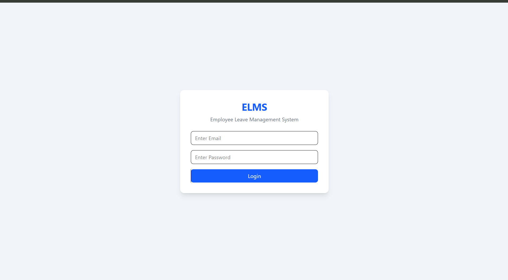
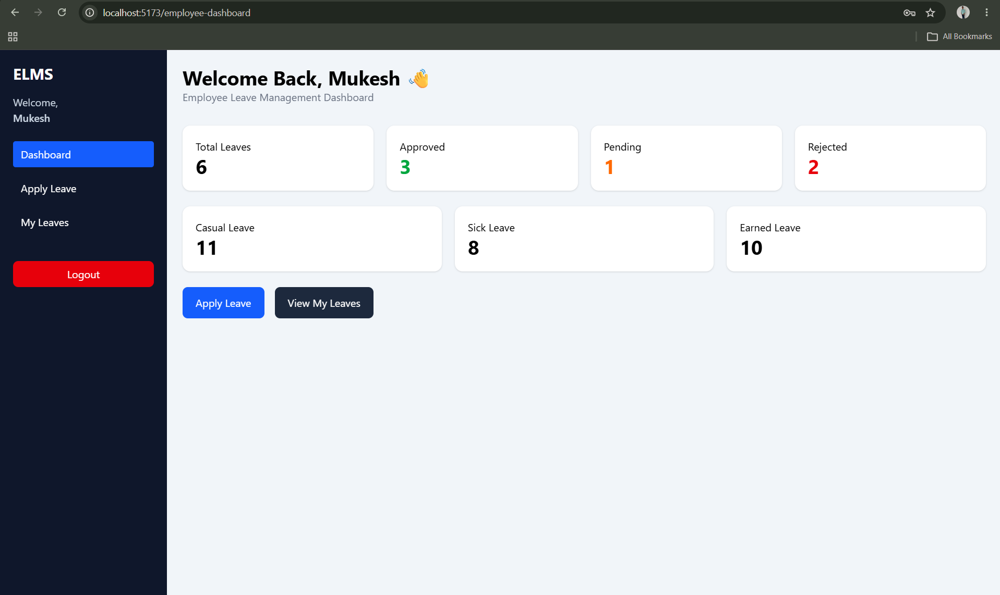
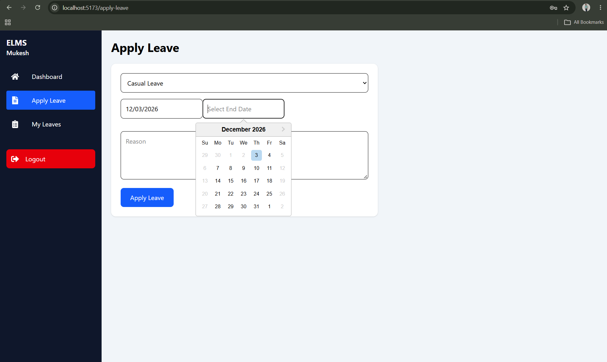
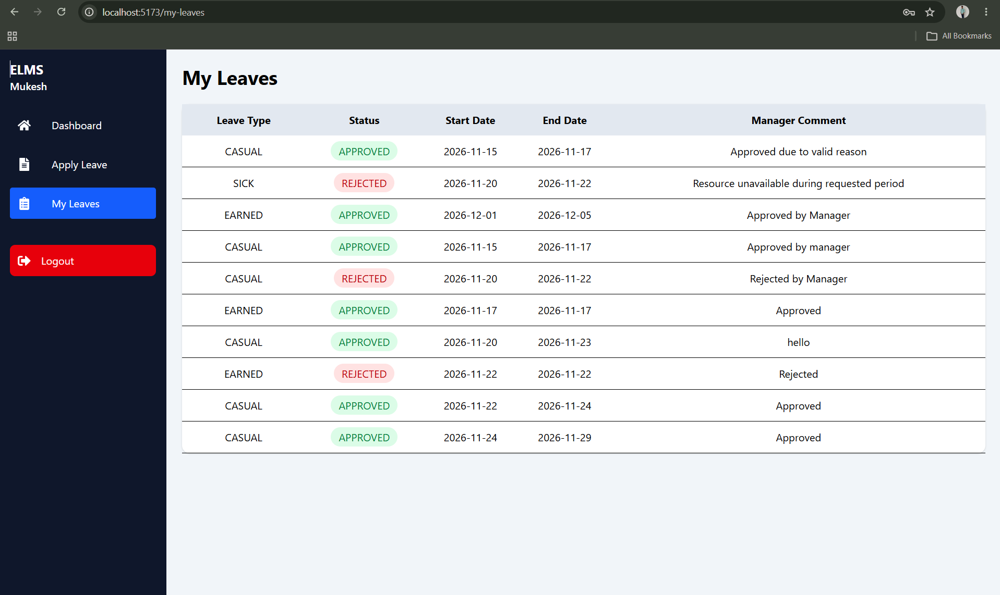
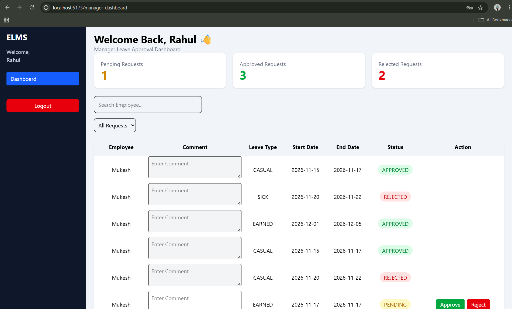
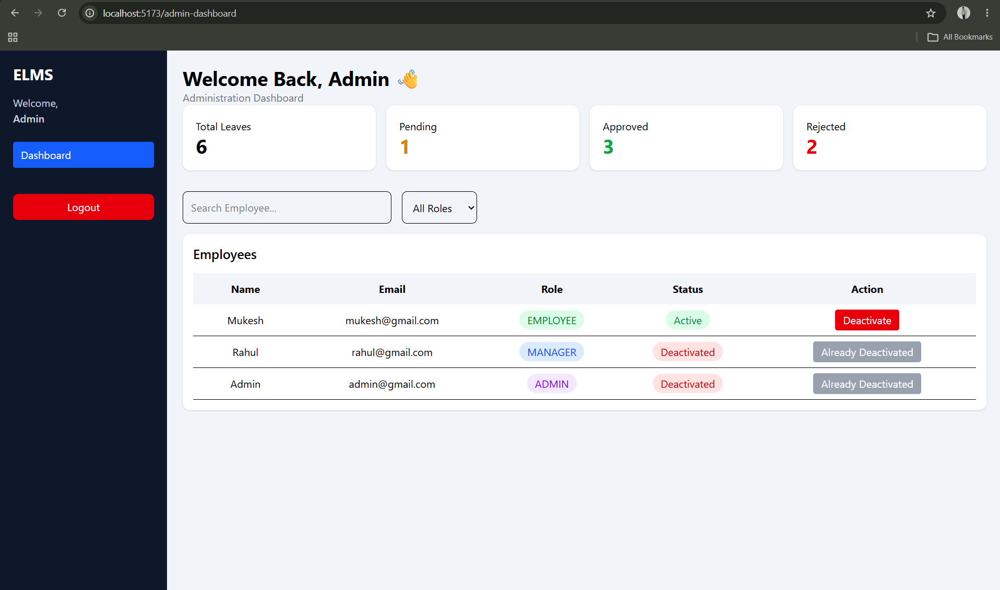

# Employee Leave Management System (ELMS)

A full-stack Employee Leave Management System (ELMS) built using Spring Boot, React, MySQL, JWT Authentication, and Tailwind CSS. The application streamlines leave management by enabling employees to apply for leaves, managers to review and approve/reject requests, and administrators to manage employees and monitor system-wide statistics.

---

## 🚀 Features

### 🔐 Authentication & Security
- User Registration
- User Login
- JWT Authentication
- Role-Based Authorization
- Protected Routes
- Secure REST APIs
- Logout Functionality

---

### 👨‍💼 Employee Module
- Employee Dashboard
- Apply Leave
- View Leave History
- Leave Balance Tracking
- Leave Status Monitoring
- Manager Comments
- Weekend Leave Restriction
- Past Date Restriction
- Holiday Exclusion Support

---

### 👨‍💻 Manager Module
- Manager Dashboard
- View Leave Requests
- Search Employees
- Filter Requests by Status
- Approve Leave Requests
- Reject Leave Requests
- Add Comments
- Dashboard Statistics

---

### 👨‍💼 Admin Module
- Admin Dashboard
- Employee Management
- Search Employees
- Filter Employees by Role
- Deactivate Employees
- System Statistics
- Active/Deactivated Status Tracking

---

### 🎨 User Experience
- Modern Responsive UI
- Tailwind CSS Styling
- Toast Notifications
- Loading Spinners
- Hover Expand Sidebar
- Role-Based Navigation
- Custom 404 Page
- Dashboard Analytics Cards

---

## 🛠️ Tech Stack

### Backend
- Java 21
- Spring Boot
- Spring Security
- JWT Authentication
- Spring Data JPA
- Hibernate
- MySQL
- Maven

### Frontend
- React
- Vite
- Tailwind CSS
- Axios
- React Router DOM
- React DatePicker
- React Icons
- React Hot Toast

### Database
- MySQL

---

## 📂 Project Structure

```text
Employee-Leave-Management-System
│
├── backend
│   ├── src
│   ├── pom.xml
│   └── application.properties
│
├── frontend
│   ├── src
│   ├── package.json
│   └── vite.config.js
│
├── screenshots
│
└── README.md
```

---

## ⚙️ Installation & Setup

### Prerequisites

Make sure the following are installed:

- Java 21
- Maven
- MySQL 8+
- Node.js (18+)
- Git
- IntelliJ IDEA / VS Code

---

## 1️⃣ Clone Repository

```bash
git clone https://github.com/your-username/Employee-Leave-Management-System.git
```

```bash
cd Employee-Leave-Management-System
```

---

# 🔧 Backend Setup

### Create Database

```sql
CREATE DATABASE elms_db;
```

---

### Configure Database

Open:

```text
backend/src/main/resources/application.properties
```

Update:

```properties
spring.datasource.url=jdbc:mysql://localhost:3306/elms_db
spring.datasource.username=root
spring.datasource.password=your_password

spring.jpa.hibernate.ddl-auto=update

jwt.secret=your_secret_key
jwt.expiration=86400000
```

---

### Run Backend

Navigate to backend folder:

```bash
cd backend
```

Run:

```bash
mvn spring-boot:run
```

Backend runs on:

```text
http://localhost:8080
```

---

# 🎨 Frontend Setup

Navigate to frontend folder:

```bash
cd frontend
```

Install dependencies:

```bash
npm install
```

---

### Required Packages

```bash
npm install axios
npm install react-router-dom
npm install react-hot-toast
npm install react-icons
npm install react-datepicker
```

---

### Run Frontend

```bash
npm run dev
```

Frontend runs on:

```text
http://localhost:5173
```

---

## 👥 Demo Accounts

### Employee

```text
Email: mukesh@gmail.com
Password: 123456
```

### Manager

```text
Email: rahul@gmail.com
Password: 123456
```

### Admin

```text
Email: admin@gmail.com
Password: 123456
```

---

## 📸 Screenshots

### Login Page



---

### Employee Dashboard



---

### Apply Leave



---

### My Leaves



---

### Manager Dashboard



---

### Admin Dashboard



---

## 🔄 Leave Approval Workflow

```text
Employee
    │
    ▼
Apply Leave
    │
    ▼
Pending Request
    │
    ▼
Manager Review
    │
 ┌──┴──┐
 ▼     ▼
Approve Reject
 │       │
 ▼       ▼
Balance  Status Updated
Updated
    │
    ▼
Employee Dashboard
```

---

## 🔒 Security Features

- JWT Token Authentication
- Stateless Session Management
- Role-Based Access Control
- Protected Frontend Routes
- Secure API Endpoints
- Authentication Filters

---

## ✅ Business Rules Implemented

- Past dates cannot be selected.
- Weekends are excluded from leave selection.
- Leave balance is automatically deducted after approval.
- Employees can only view their own leave records.
- Managers can approve/reject leave requests.
- Admin can deactivate employees.
- Role-based dashboard access.

---

## 🌟 Future Enhancements

- Email Notifications
- Holiday Management Module
- Profile Management
- Dark Mode
- Charts & Analytics
- Docker Support
- AWS/Azure Deployment
- Pagination
- Export Reports

---

## 📈 Project Status

### ELMS v1.0 ✅

Completed Features:

- Authentication & Authorization
- ytics
- Responsive Frontend
- Search & Filtering
- Notification System

---

## 👨‍💻 Author

**Shivam Pandey**

Full Stack Java Developer

### Technologies Used

```text
Spring Boot | Spring Security | JWT | React
MySQL | Tailwind CSS | Axios | Vite
```

---

## 📄 License

This project is created for educational, portfolio, and learning purposes.
